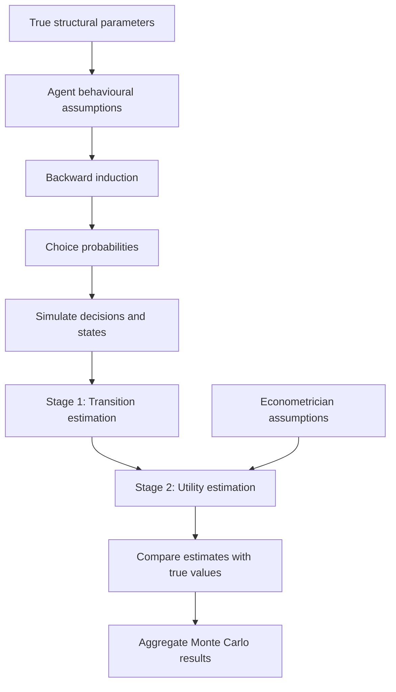

# Technical Methodology

**Dynamic Discrete Choice Models under Behavioural Misspecification**

This document describes the mathematical framework, structural estimation procedure and Monte Carlo design of the original research conducted at Heinrich Heine University Düsseldorf in 2025. The model is a finite-horizon adaptation of Rust (1987).

[Return to repository overview](README.md)

## 1. Model specification

### Decision environment

An agent repeatedly chooses whether to maintain or replace a bus engine over a finite horizon of 60 months. The observable state is accumulated mileage since the most recent engine replacement. The decision and state spaces are

```math
\begin{alignedat}{2}
&t   &\quad &\in \{1,\ldots,T\}, \qquad T=60,\\
&a_t &\quad &\in \mathcal A=\{0,1\},\\
&x_t &\quad &\in \mathcal X=\{0,5000,\ldots,350000\}.
\end{alignedat}
```

Action $0$ denotes maintaining the engine; action $1$ denotes replacing it. The full state also includes alternative-specific utility shocks observed by the agent but not by the econometrician:

```math
s_t=(x_t,\varepsilon_t).
```

### Instantaneous utility

Utility is additively separable in a deterministic component and an unobserved shock:

```math
U(x_t,\varepsilon_t,a_t;\theta_u)=u(x_t,a_t;\theta_u)+\varepsilon_t(a_t).
```

The deterministic component is

```math
u(x_t,a_t;\theta_u)=
\begin{cases}
-\theta_c x_t, & a_t=0,\\
-RC, & a_t=1.
\end{cases}
```

The utility parameters are the replacement cost and the marginal maintenance cost:

```math
\theta_u=(RC,\theta_c), \qquad c(x_t;\theta_c)=\theta_c x_t.
```

Replacing the engine resets mileage, so maintenance costs in the replacement period are zero. The agent trades off immediate replacement costs against future maintenance savings.

The normalisation of maintenance costs at zero mileage and the restriction that replacement costs do not depend on mileage are part of the original utility specification. The utility shocks are independently and identically distributed Type I Extreme Value (Gumbel) shocks, with the usual scale normalisation.

## 2. Stochastic state dynamics

The state follows a first-order Markov process: the conditional distribution of the next state depends only on the current state and action. Future utility shocks evolve independently of the observable state transitions:

```math
f_s(x_{t+1},\varepsilon_{t+1}\mid x_t,\varepsilon_t,a_t)
=f_x(x_{t+1}\mid x_t,a_t)f_\varepsilon(\varepsilon_{t+1}).
```

Monthly mileage increments take one of three values:

```math
\Delta x_t\in\{0,5000,10000\},\qquad \theta_f=(p_0,p_1,p_2),\qquad \sum_{j=0}^{2}p_j=1.
```

| Increment | Baseline probability |
| --- | ---: |
| 0 km | 0.3919 |
| 5,000 km | 0.5953 |
| 10,000 km | 0.0128 |

Away from the upper boundary of the state grid, the state transition is

```math
x_{t+1}=\begin{cases}
x_t+\Delta x_t,&a_t=0,\\
\Delta x_t,&a_t=1.
\end{cases}
```

When the engine is maintained, mileage accumulates; when replaced, mileage is reset before the next increment is realised. The original thesis does not explicitly specify the treatment of transitions beyond the upper grid boundary in this expression.

Writing the action-specific transition probabilities as matrices gives

```math
P_a(x,x')=f_x(x'\mid x,a),\qquad \sum_{x'\in\mathcal X}P_a(x,x')=1.
```

## 3. Dynamic optimisation

### Intertemporal objective

The agent chooses a policy that maximises expected discounted utility over the remaining decision horizon:

```math
\max_{\delta}\;\mathbb E^{\delta}\left[\sum_{\tau=t}^{T}\beta^{\tau-t}U(x_\tau,\varepsilon_\tau,a_\tau)\mid x_t,\varepsilon_t\right],\qquad \beta\in[0,1].
```

The discount factor determines the weight attached to future utility relative to current utility.

### Bellman equation

The problem can be expressed recursively:

```math
V_t(x,\varepsilon)=\max_{a\in\mathcal A}\left\{u(x,a)+\varepsilon(a)+\beta\mathbb E[V_{t+1}(x',\varepsilon')\mid x,a]\right\}.
```

Define the conditional value function, excluding the current utility shock, as

```math
v_t(x,a)=u(x,a)+\beta\sum_{x'\in\mathcal X}P_a(x,x')\overline V_{t+1}(x').
```

The ex-ante value function integrates over the utility shocks:

```math
\overline V_t(x)=\mathbb E_\varepsilon\left[\max_{a\in\mathcal A}\{v_t(x,a)+\varepsilon(a)\}\right].
```

Under unit-scale Gumbel shocks, with the location normalised to omit the additive Euler constant, this expectation has the log-sum-exp representation used in the thesis:

```math
\overline V_t(x)=\log\left(\sum_{a\in\mathcal A}\exp(v_t(x,a))\right).
```

For numerical implementation, the conditional value recursion can equivalently be written in matrix form:

```math
\mathbf v_{t,a}=\mathbf u_a+\beta P_a\overline{\mathbf V}_{t+1}.
```

This matrix expression is an equivalent reformulation of the original scalar equations.

## 4. Numerical solution by backward induction

Unlike the infinite-horizon model of Rust (1987), the finite-horizon specification can be solved by backward induction.

**Terminal period:** No continuation utility remains after period $T$:

```math
v_T(x,a)=u(x,a),\qquad \overline V_T(x)=\log\left(\sum_a\exp(u(x,a))\right).
```

**Backward recursion:** For each preceding period, compute the conditional and ex-ante value functions:

```math
\begin{aligned}
v_t(x,a)&=u(x,a)+\beta\sum_{x'}P_a(x,x')\overline V_{t+1}(x'),\\
\overline V_t(x)&=\log\left(\sum_a\exp(v_t(x,a))\right),
\qquad t=T-1,\ldots,1.
\end{aligned}
```

The recursion yields value functions for every combination of state, action and period.

## 5. Conditional choice probabilities

The agent selects the alternative offering the highest lifetime utility conditional on the current shocks:

```math
a_t^*=\arg\max_{a\in\mathcal A}\{v_t(x_t,a)+\varepsilon_t(a)\}.
```

Integrating over the Gumbel shocks yields the logit choice probabilities:

```math
\Pr_t(a\mid x)=\frac{\exp(v_t(x,a))}{\sum_{a'\in\mathcal A}\exp(v_t(x,a'))}.
```

For the binary replacement decision, this simplifies to

```math
\Pr_t(a=1\mid x)=\frac{1}{1+\exp(v_t(x,0)-v_t(x,1))}.
```

The replacement probability depends on the difference between the expected lifetime utilities of the two alternatives, not on their absolute levels. Incorrect assumptions about continuation utility can therefore distort the predicted choice probabilities.

## 6. Structural parameter estimation

The econometrician observes states and actions but not the underlying structural parameters:

```math
\theta=(\theta_f,\theta_u),\qquad \theta_f=(p_0,p_1,p_2),\qquad \theta_u=(RC,\theta_c).
```

### Likelihood decomposition

Conditional on initial states, the log-likelihood consists of a state-transition component and a conditional-choice component:

```math
\ell(\theta)=\ell_f(\theta_f)+\ell_a(\theta_u,\theta_f).
```

With $T$ observed decision periods and $T-1$ observed transitions per bus, the components are

```math
\ell_f(\theta_f)=\sum_{i=1}^{N}\sum_{t=1}^{T-1}\log f_x(x_{i,t+1}\mid x_{it},a_{it};\theta_f),
```

```math
\ell_a(\theta_u,\theta_f)=\sum_{i=1}^{N}\sum_{t=1}^{T}\log\Pr_t(a_{it}\mid x_{it};\theta_u,\theta_f).
```

The original research uses a two-stage procedure, rather than jointly maximising the full likelihood.

### Stage 1: Transition parameter estimation

The first stage estimates objective transition probabilities using the relative frequencies of mileage changes in periods without engine replacement. This avoids treating the mileage reset as a natural state increment.

Let $n_j$ denote the number of eligible observations of increment $j$. Then

```math
\widehat p_j=\frac{n_j}{\sum_{k=0}^{2}n_k},\qquad \widehat\theta_f=(\widehat p_0,\widehat p_1,\widehat p_2).
```

This is the categorical maximum likelihood estimator for the observed increments, when those increments are directly observed. The first stage does not require assumptions about the agent's discount factor, foresight or subjective beliefs.

### Stage 2: Utility parameter estimation

Holding the estimated transition parameters fixed, the econometrician maximises the choice log-likelihood:

```math
\widehat\theta_u=\arg\max_{\theta_u}\sum_{i=1}^{N}\sum_{t=1}^{T}\log\Pr_t(a_{it}\mid x_{it};\theta_u,\widehat\theta_f).
```

Choice probabilities depend on the dynamic value functions. The dynamic problem must therefore be solved for each candidate utility parameter vector evaluated during optimisation.

| Computational level | Responsibility |
| --- | --- |
| Inner recursion | Solve the dynamic decision problem by backward induction. |
| Outer optimisation | Maximise the conditional-choice log-likelihood. |

This is a finite-horizon analogue of Rust's nested fixed-point approach: backward induction replaces the infinite-horizon fixed-point computation.

## 7. Behavioural misspecification

The research distinguishes the behavioural assumptions governing the data-generating process from those imposed during estimation. The econometrician maintains a discount factor of $0.8$, full foresight and correct beliefs about objective transitions in the main experiments. Each variant changes one behavioural dimension at a time.

### Variant 1: Discount factor misspecification

The agent's discount factor varies over the following grid, while the econometrician fixes it at $0.8$:

```math
\beta^{\mathrm{agent}}\in\{0,0.2,0.4,0.6,0.8,1\},\qquad \beta^{\mathrm{model}}=0.8.
```

The conditional value functions differ because future utility receives different weights:

```math
v_t^{\mathrm{agent}}(x,a)=u(x,a)+\beta^{\mathrm{agent}}\sum_{x'}P_a(x,x')\overline V_{t+1}^{\mathrm{agent}}(x'),
```

```math
v_t^{\mathrm{model}}(x,a)=u(x,a)+\beta^{\mathrm{model}}\sum_{x'}P_a(x,x')\overline V_{t+1}^{\mathrm{model}}(x').
```

When the econometrician overestimates the discount factor, the model predicts more replacement activity than the agent exhibits in the original discount-factor experiment. The estimator may compensate by increasing estimated replacement costs and decreasing estimated maintenance costs. The reverse pattern occurs when the agent is more forward-looking than assumed.

### Variant 2: Limited foresight

At each period $t$, a limited-foresight agent considers at most the next h periods. The effective planning horizon is

```math
H_t=\min\{t+h,T\}.
```

The agent's backward induction starts at this effective terminal period, with no continuation utility beyond it:

```math
v_{H_t}(x,a)=u(x,a),\qquad \overline V_{H_t}(x)=\log\left(\sum_a\exp(u(x,a))\right).
```

The investigated planning horizons are

```math
h\in\{0,2,4,6,8,25,40,60\}.
```

A horizon of zero is myopic behaviour, while a horizon of $60$ implies full foresight over the remaining decision periods. The agent's effective terminal period is recalculated as time advances. The econometrician always assumes full foresight in this experiment.

### Variant 3: Subjective transition beliefs

The agent's subjective mileage-increment probabilities are constructed as a convex combination of the true probabilities and an extreme belief:

```math
\theta_f^{\mathrm{agent}}(\alpha)=(1-\alpha)\theta_f^{\mathrm{true}}+\alpha\theta_f^{\mathrm{extreme}}.
```

```math
\alpha\in\{0,0.2,0.4,0.6,0.8,1\}.
```

The two extreme beliefs are

```math
\begin{aligned}
\theta_f^{\mathrm{optimistic}}&=(1,0,0),\\
\theta_f^{\mathrm{pessimistic}}&=(0,0,1).
\end{aligned}
```

The optimistic agent increasingly expects no additional mileage; the pessimistic agent increasingly expects $10,000$ km of additional mileage each month.

The agent uses subjective probabilities when computing continuation utility:

```math
v_t^{\mathrm{agent}}(x,a)=u(x,a)+\beta\sum_{x'}P_a^{\mathrm{agent}}(x,x')\overline V_{t+1}^{\mathrm{agent}}(x').
```

Actual mileage increments continue to follow the objective distribution. The econometrician estimates that distribution and uses it in the second-stage choice model:

```math
v_t^{\mathrm{model}}(x,a)=u(x,a)+\beta\sum_{x'}\widehat P_a^{\mathrm{true}}(x,x')\overline V_{t+1}^{\mathrm{model}}(x').
```

Consequently, even accurately estimated objective probabilities can lead to biased utility estimates when used as a substitute for subjective beliefs. This distinction is central to the original thesis.

## 8. Monte Carlo experimental design

### Baseline calibration

| Parameter | Value | Interpretation |
| --- | ---: | --- |
| N | 1,000 | Identical simulated buses |
| T | 60 | Monthly decision periods |
| R | 60 | Repetitions per specification |
| Discount factor | 0.8 | Baseline time preference |
| RC | 15.075 | Replacement cost |
| Maintenance cost coefficient | 0.0005293 | Marginal maintenance cost |
| p0 | 0.3919 | Probability of 0 km |
| p1 | 0.5953 | Probability of 5,000 km |
| p2 | 0.0128 | Probability of 10,000 km |
| State-space cardinality | 71 | Discrete mileage states |

Each dataset contains $60,000$ decision observations. Across 60 repetitions, each specification generates $3.6$ million decision observations.

### Synthetic data generation

All buses begin with zero accumulated mileage:

```math
x_{i1}=0\qquad\forall i.
```

First, solve the agent's decision problem under the relevant behavioural specification. Then simulate decisions by comparing the corresponding replacement probability with a uniform random draw:

```math
z_{it}\sim\mathcal U(0,1),\qquad a_{it}=\mathbf 1\{z_{it}<\Pr_t^{\mathrm{agent}}(1\mid x_{it})\}.
```

Independently draw a mileage increment from the objective distribution and update the mileage state according to the chosen action. The use of objective probabilities for realised transitions is maintained even when agents hold subjective beliefs.

### Estimation and repetition

For each behavioural specification:

1. Solve the agent's dynamic decision problem.
2. Simulate a panel of decisions and states.
3. Estimate objective transition probabilities.
4. Estimate utility parameters under the econometrician's maintained assumptions.
5. Record parameter estimates and replacement counts.
6. Repeat for $R = 60$ simulated panels and aggregate the results.



## 9. Statistical evaluation

For a generic parameter with true value theta-zero, calculate the Monte Carlo mean and its percentage deviation from the truth:

```math
\overline{\widehat\theta}=\frac{1}{R}\sum_{r=1}^{R}\widehat\theta^{(r)},
```

```math
\widehat{\mathrm{Bias}}_{\%}=100\frac{\overline{\widehat\theta}-\theta^0}{\theta^0}.
```

The original analysis reports 95% confidence intervals to describe uncertainty across Monte Carlo repetitions. Relative bias should be interpreted carefully for small transition probabilities, where small absolute deviations can produce large percentage deviations.

To investigate how misspecification changes behaviour, the original research also computes average replacements per bus over the entire decision horizon:

```math
\overline A=\frac{1}{RN}\sum_{r=1}^{R}\sum_{i=1}^{N}\sum_{t=1}^{T}a_{it}^{(r)}.
```

## 10. Robustness analysis

The limited-foresight experiment is repeated under four alternative calibrations, varying one component at a time:

| Scenario | Alternative value |
| --- | --- |
| Higher maintenance costs | Maintenance coefficient = 0.001 |
| Higher replacement costs | RC = 50 |
| Alternative objective transition probabilities | (0.1, 0.3, 0.6) |
| Greater future orientation | Agent and model discount factors = 0.99 |

The alternative transition distribution changes the objective data-generating process, not merely subjective beliefs. In the higher-discount-factor scenario both the agent and the econometrician use 0.99. Limited foresight remains the sole behavioural misspecification in these experiments.

The analysis compares utility parameter bias and the stability of average replacement behaviour across planning horizons. These are the scenarios documented in Appendix A.1 of the original thesis.

## 11. Interpretation of the original findings

### Structural estimation under misspecification

Maximum likelihood estimation chooses parameter values that best explain observed data within the assumed model. If the econometrician's behavioural assumptions imply incorrect choice probabilities at the true parameter values, the estimator may compensate by adjusting the utility parameters. A good fit therefore does not necessarily imply accurate structural parameter recovery.

### Remarkable robustness to limited foresight

In the original baseline experiment, utility parameter estimates are substantially distorted at short planning horizons, but from six future periods onwards the reported percentage biases are no longer statistically distinguishable from zero. The econometrician nevertheless continues to assume full foresight.

| Foresight (future periods) | Average replacements per bus (original thesis) |
| ---: | ---: |
| 0 | 5.75 |
| 2 | 11.77 |
| 4 | 11.56 |
| 6 | 11.47 |
| 8 | 11.50 |
| 25 | 11.50 |
| 40 | 11.50 |
| 60 | 11.50 |

Average replacement behaviour approximately stabilises at the same point at which detectable estimation bias disappears. The robustness experiments provide further evidence for this relationship.

**Central insight:** Formally incorrect behavioural assumptions do not necessarily cause estimation bias when they remain compatible with actual decision-making behaviour. A fully forward-looking model can therefore perform well even if agents have limited, but sufficiently extensive, foresight.

### Robustness of transition estimates

The objective transition probabilities are comparatively robust across the original behavioural misspecification experiments because they are estimated from realised mileage increments. Utility estimates are more sensitive because the second-stage model incorporates behavioural assumptions.

Under subjective transition beliefs, accurate first-stage estimates still fail to describe the probability distribution on which the agent bases decisions. The correct objective estimates can consequently become the source of misspecification in the second stage.

### Additional mathematical interpretation

The following equivalent reformulation clarifies the mechanism, but was not explicitly developed in the original thesis. In a binary logit model, choice probabilities depend on the conditional value difference:

```math
\Delta v_t(x)=v_t(x,1)-v_t(x,0).
```

If limited and full foresight produce approximately equal conditional value differences, they generate approximately equal conditional choice probabilities. Exact equality across all relevant states and periods would imply identical conditional choice probabilities. Similar aggregate replacement counts alone do not establish this equality.

## 12. Implementation architecture

| Module | Purpose |
| --- | --- |
| `config.py` | Parameter configuration |
| `model.py` | Model specification |
| `transitions.py` | Transition dynamics |
| `solver.py` | Dynamic programming |
| `limited_foresight.py` | Restricted planning horizons |
| `simulation.py` | Synthetic panel generation |
| `estimation.py`, `utility_estimation.py` | Structural parameter estimation |
| `monte_carlo_variant1.py` | Discount factor experiment |
| `monte_carlo_variant2.py` | Limited foresight experiment |
| `monte_carlo_variant3.py` | Subjective beliefs experiment |
| `monte_carlo_robustness.py` | Alternative calibrations |
| `plot_results.py`, `plot_appendix.py` | Figures and tables |

The module descriptions follow the intended project structure and original variant numbering. Implementation details are defined by the Python source files.

## 13. Limitations and reproducibility

- The six-period threshold is specific to the baseline calibration and is not a universal property of dynamic discrete choice models.
- The discount factor is externally specified rather than jointly estimated with utility parameters, reflecting identification difficulties.
- The simulation uses a representative agent with homogeneous behaviour and fixed subjective expectations; learning and behavioural heterogeneity are not modelled.
- The first-stage estimation procedure relies on the simplified transition specification.
- The absence of statistically detectable Monte Carlo bias is not a general proof of unbiasedness or consistency under misspecification.

## 14. References

- Aguirregabiria, V., & Mira, P. (2010). Dynamic discrete choice structural models: A survey. *Journal of Econometrics*, 156(1), 38–67.
- Bellman, R. (1957). *Dynamic Programming*. Princeton University Press.
- Magnac, T., & Thesmar, D. (2002). Identifying dynamic discrete decision processes. *Econometrica*, 70(2), 801–816.
- Rust, J. (1987). Optimal replacement of GMC bus engines: An empirical model of Harold Zurcher. *Econometrica*, 55(5), 999–1033.
- White, H. (1982). Maximum likelihood estimation of misspecified models. *Econometrica*, 50(1), 1–25.

---

**Author:** Elias Roth  
Based on original research conducted at Heinrich Heine University Düsseldorf in 2025.

[Return to repository overview](README.md)
