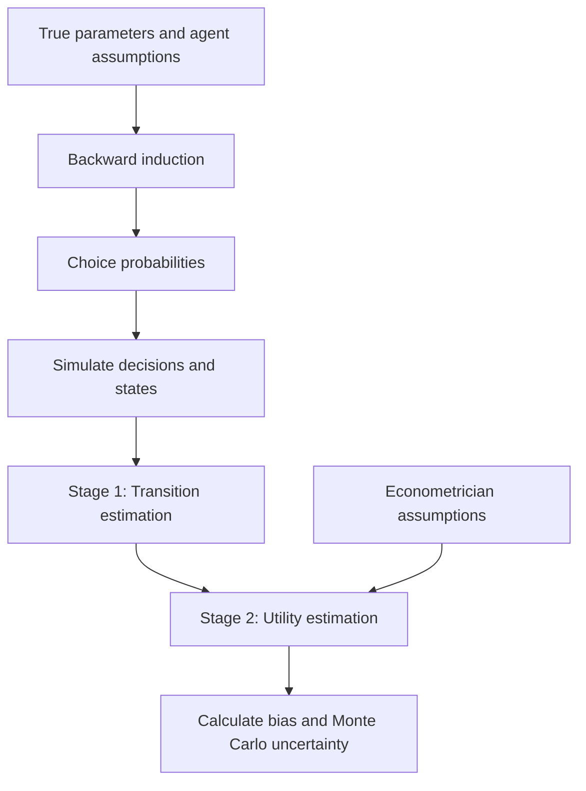

# Technical Methodology

**Dynamic Discrete Choice Models under Behavioural Misspecification**

This document describes the mathematical model, numerical solution and Monte Carlo estimation framework implemented in Python, based on my bachelor's thesis at Heinrich Heine University Düsseldorf (2025). The model is a finite-horizon adaptation of Rust (1987).

[Return to repository overview](README.md)

<br>

## 1. Model specification

An agent chooses each month whether to maintain or replace a bus engine over a finite horizon of 60 months. The observable state is accumulated mileage since the last replacement.

```math
\begin{alignedat}{2}
&t &\quad &\in\{1,\ldots,T\},\qquad T=60,\\
&a_t &\quad &\in\mathcal A=\{0,1\},\\
&x_t &\quad &\in\mathcal X=\{0,5000,\ldots,350000\}.
\end{alignedat}
```

<br>

Action $0$ denotes maintaining the engine; action $1$ denotes replacing it. The full state is $s_t=(x_t,\varepsilon_t)$, where $\varepsilon_t$ collects the two alternative-specific utility shocks. Utility consists of a deterministic component and an alternative-specific shock observed by the agent but not by the econometrician:

```math
U(x_t,\varepsilon_t,a_t;\theta_u)=u(x_t,a_t;\theta_u)+\varepsilon_t(a_t),
```

<br>

where

```math
u(x_t,a_t;\theta_u)=
\begin{cases}
-\theta_c x_t,&a_t=0,\\
-RC,&a_t=1.
\end{cases}
```

<br>

The structural utility parameters are $\theta_u=(RC,\theta_c)$: the replacement cost and the marginal maintenance cost. Replacing the engine resets mileage, eliminating maintenance costs in the current period and potentially reducing future maintenance costs.

The shocks are independently and identically distributed Type I Extreme Value (Gumbel), with unit scale and location normalised to omit the additive Euler constant. This assumption yields the closed-form choice probabilities used below.

<br>

## 2. Stochastic state dynamics

Mileage follows a first-order Markov process: the distribution of the next state depends only on the current state and action. Future utility shocks are independent of mileage transitions. The joint state transition therefore factorises as

```math
f_s(x_{t+1},\varepsilon_{t+1}\mid x_t,\varepsilon_t,a_t)
=f_x(x_{t+1}\mid x_t,a_t)f_\varepsilon(\varepsilon_{t+1}).
```

<br>

This conditional independence allows the continuation value to be expressed in terms of mileage alone after integrating out future utility shocks.

Monthly mileage increments satisfy

```math
\Delta x_t\in\{0,5000,10000\},\qquad
\theta_f=(p_0,p_1,p_2),\qquad \sum_{j=0}^{2}p_j=1.
```

<br>

The uncapped state transition is

```math
x_{t+1}=\begin{cases}
x_t+\Delta x_t,&a_t=0,\\
\Delta x_t,&a_t=1.
\end{cases}
```

<br>

When the engine is maintained, mileage accumulates. When it is replaced, mileage resets before the next increment is realised.

For dynamic programming, the transition matrices assign any mileage beyond 350,000 km to the highest grid state. Each action-specific matrix satisfies

```math
P_a(x,x')=\Pr(x_{t+1}=x'\mid x_t=x,a_t=a),\qquad
\sum_{x'\in\mathcal X}P_a(x,x')=1.
```

<br>

The simulation uses uncapped mileage increments; the corresponding boundary limitation is discussed in Section 9.

<br>

## 3. Dynamic optimisation and numerical solution

### Intertemporal objective

The agent chooses a policy $\delta$ to maximise expected discounted utility over the remaining horizon:

```math
\max_{\delta}\;\mathbb E^{\delta}\left[
\sum_{\tau=t}^{T}\beta^{\tau-t}U(x_\tau,\varepsilon_\tau,a_\tau)
\mid x_t,\varepsilon_t\right],\qquad \beta\in[0,1].
```

<br>

The Bellman equation expresses the value of the optimal decision as current utility plus discounted expected continuation utility:

```math
V_t(x,\varepsilon)=\max_{a\in\mathcal A}
\left\{u(x,a)+\varepsilon(a)+\beta\mathbb E[V_{t+1}(x',\varepsilon')\mid x,a]\right\}.
```

<br>

### Integrating out the utility shocks

Define the choice-specific value function, excluding the current shock, as

```math
v_t(x,a)=u(x,a)+\beta\sum_{x'\in\mathcal X}P_a(x,x')\overline V_{t+1}(x').
```

<br>

The ex-ante value function integrates over the current shocks. Under the Gumbel assumption,

```math
\begin{alignedat}{2}
&\overline V_t(x) &\quad &=\mathbb E_\varepsilon\left[\max_a\{v_t(x,a)+\varepsilon(a)\}\right]\\
& &\quad &=\log\left(\sum_{a\in\mathcal A}\exp(v_t(x,a))\right).
\end{alignedat}
```

<br>

### Backward induction

Unlike Rust's infinite-horizon model, the finite-horizon problem can be solved directly by backward induction. Set $\overline V_{T+1}(x)=0$ for every state. In the final decision period, the agent therefore compares only current utilities:

```math
v_T(x,a)=u(x,a),\qquad
\overline V_T(x)=\log\left(\sum_a\exp(u(x,a))\right).
```

<br>

Working backwards from period $T$ to period $1$, the solver evaluates both alternatives in every state and uses the resulting ex-ante values to calculate the continuation utility of the preceding period. In matrix notation, the choice-specific recursion is

```math
\mathbf v_{t,a}=\mathbf u_a+\beta P_a\overline{\mathbf V}_{t+1}.
```

<br>

The transition matrix multiplies the vector of next-period values to obtain expected continuation utility for every current state simultaneously. The ex-ante value function is then updated using the log-sum-exp formula above.

The Python solver uses `np.logaddexp` to calculate this expression without directly exponentiating large values.

### Conditional choice probabilities

The agent chooses the alternative with the highest shock-inclusive value. Integrating over the shocks gives the logit probabilities:

```math
\Pr_t(a\mid x)=\frac{\exp(v_t(x,a))}{\sum_{a'\in\mathcal A}\exp(v_t(x,a'))}.
```

<br>

For the binary replacement decision,

```math
\Pr_t(1\mid x)=\frac{1}{1+\exp(v_t(x,0)-v_t(x,1))}.
```

<br>

Choice probabilities depend on the difference between the two choice-specific values, rather than their absolute levels. Incorrect assumptions about continuation utility can therefore change predicted decisions.

For numerical stability, the implementation calculates both log choice probabilities directly:

```math
\begin{alignedat}{2}
&\log\Pr_t(0\mid x) &\quad &=-\log\left(1+\exp(v_t(x,1)-v_t(x,0))\right),\\
&\log\Pr_t(1\mid x) &\quad &=-\log\left(1+\exp(v_t(x,0)-v_t(x,1))\right).
\end{alignedat}
```

<br>

These expressions are evaluated using NumPy's `np.logaddexp` function to avoid numerical overflow and taking the logarithm of probabilities that may have rounded to zero during numerical optimisation.

<br>

## 4. Two-stage maximum likelihood estimation

The econometrician observes decisions and realised mileage but not the underlying parameters $\theta=(\theta_f,\theta_u)$. Conditional on the initial states, the full log-likelihood decomposes into a state-transition and a conditional-choice component:

```math
\begin{alignedat}{2}
&\ell(\theta) &\quad &=\ell_f(\theta_f)+\ell_a(\theta_u,\theta_f),\\
&\ell_f(\theta_f) &\quad &=\sum_{i=1}^{N}\sum_{t=1}^{T}\log f_x(x_{i,t+1}\mid x_{it},a_{it};\theta_f),\\
&\ell_a(\theta_u,\theta_f) &\quad &=\sum_{i=1}^{N}\sum_{t=1}^{T}\log\Pr_t(a_{it}\mid x_{it};\theta_u,\theta_f).
\end{alignedat}
```

<br>

The simulation records mileage after the final decision, so there are $T$ recorded transitions per bus. A panel recording only states and actions through period $T$ would instead contain $T-1$ transitions. The likelihood decomposition describes the model; the implemented two-stage procedure uses only non-replacement observations in its transition estimation, rather than jointly maximising the full likelihood.

### Stage 1: Transition parameter estimation

Only observations without engine replacement are used, so a mileage reset is not mistaken for a natural mileage increment. Let $n_j$ count eligible observations with increment $5000j$ km. The categorical maximum likelihood estimates for these increments are

```math
\widehat p_j=\frac{n_j}{\sum_{k=0}^{2}n_k},\qquad j\in\{0,1,2\}.
```

<br>

The implementation calculates the first two frequencies and obtains the third from $\widehat p_2=1-\widehat p_0-\widehat p_1$. This stage uses realised mileage changes, including eligible final-period observations, and does not require assumptions about the agent's foresight, discount factor or subjective beliefs. Since the increment is drawn independently of the current decision, conditioning on the keep action does not alter its objective distribution under the simulated data-generating process.

### Stage 2: Utility parameter estimation

Holding the estimated transition probabilities fixed, the econometrician maximises the choice log-likelihood under the assumed behavioural model:

```math
\widehat\theta_u=\arg\max_{\theta_u}\sum_{i=1}^{N}\sum_{t=1}^{T}
\log\Pr_t(a_{it}\mid x_{it};\theta_u,\widehat\theta_f).
```

<br>

For each candidate utility parameter vector, the dynamic model is solved again to obtain the corresponding choice probabilities. This gives a finite-horizon analogue of Rust's nested fixed-point approach, with backward induction replacing the inner fixed-point computation.

### Efficient likelihood evaluation

Observations sharing the same action, state and period have identical likelihood contributions. Let $n_{a,x,t}$ count these observations. The equivalent choice log-likelihood is

```math
\ell_a(\theta_u,\widehat\theta_f)=\sum_{t=1}^{T}\sum_{x\in\mathcal X}\sum_{a\in\mathcal A}
n_{a,x,t}\log\Pr_t(a\mid x;\theta_u,\widehat\theta_f).
```

<br>

The counts are computed once before optimisation, avoiding repeated processing of the full simulated panel. With 71 mileage states, 60 periods and two actions, the likelihood can be evaluated using a fixed array of 8,520 cells rather than summing over all 60,000 individual decisions at every evaluation. The dynamic model must still be solved for each candidate parameter vector.

### Numerical optimisation

The maintenance cost coefficient is rescaled into cost per 5,000 km to improve numerical conditioning:

```math
\widetilde\theta_u=(RC,5000\theta_c).
```

<br>

The optimiser minimises the negative choice log-likelihood divided by the number of observations. This changes its scale but not its minimiser. The starting values are $RC=14$ and $\theta_c=0.0001$, and the bounds in the original units are $0\leq RC\leq 10000$ and $0\leq\theta_c\leq 1$. The implementation uses bounded L-BFGS-B with a bounded Nelder–Mead fallback, and checks convergence, finiteness and improvement over the starting objective within numerical tolerance.

<br>

## 5. Behavioural misspecification

The data-generating process uses the agent's actual behavioural assumptions; estimation uses the econometrician's maintained assumptions. Across all three experiments, the econometrician assumes a discount factor of 0.8, full foresight and beliefs consistent with objective transitions. Each experiment changes one behavioural dimension at a time.

### Variant 1: Discount factor misspecification

```math
\beta^{\mathrm{agent}}\in\{0,0.2,0.4,0.6,0.8,1\},\qquad \beta^{\mathrm{model}}=0.8.
```

<br>

Both the agent and the econometrician consider all remaining periods, but they assign different weights to continuation utility. If the agent discounts the future more heavily than assumed, future maintenance savings are less valuable. The econometrician may attribute the resulting differences in choices to higher replacement costs or lower maintenance costs.

### Variant 2: Limited foresight

At each decision, the agent considers the current period plus at most $h$ future periods. The effective terminal period is

```math
H_t=\min\{t+h,T\},\qquad h\in\{0,2,4,6,8,25,40,60\}.
```

<br>

The agent solves the dynamic problem with zero continuation utility beyond $H_t$. The terminal condition of the restricted problem is therefore $v_{H_t}(x,a)=u(x,a)$. This planning window moves forward as time advances: the agent does not commit to the policy computed in the first period, but evaluates the remaining alternatives using the same foresight restriction at each decision. At $h=0$ the agent is myopic; at $h=60$ the agent considers all remaining periods. The econometrician always assumes full foresight.

Because utility and transition matrices do not depend on calendar time, the implementation solves a shorter model once for each horizon and reuses the relevant columns. Define

```math
L=\min\{h+1,T\},\qquad L_t=\min\{L,T-t+1\}.
```

<br>

The appropriate zero-based column index in the shorter solution is $L-L_t$. This avoids solving a separate dynamic problem at every calendar period. The implementation tests agreement with the myopic decision rule and with the full-horizon solution when all remaining periods are considered.

### Variant 3: Subjective transition beliefs

The agent forms subjective beliefs by taking a convex combination of the true transition probabilities and an extreme belief:

```math
\theta_f^{\mathrm{agent}}(\alpha)=(1-\alpha)\theta_f^{\mathrm{true}}+\alpha\theta_f^{\mathrm{extreme}},
\qquad \alpha\in\{0,0.2,0.4,0.6,0.8,1\}.
```

<br>

The extreme beliefs are

```math
\theta_f^{\mathrm{optimistic}}=(1,0,0),\qquad
\theta_f^{\mathrm{pessimistic}}=(0,0,1).
```

<br>

The optimistic agent increasingly expects zero additional mileage; the pessimistic agent increasingly expects 10,000 km per period. Subjective probabilities determine the agent's continuation values and choice probabilities, but realised mileage growth continues to follow the objective distribution.

The distinction can be expressed directly in the continuation-value term. The agent uses subjective transition matrices, whereas the econometrician uses the matrices constructed from estimated objective probabilities:

```math
\begin{alignedat}{2}
&v_t^{\mathrm{agent}}(x,a) &\quad &=u(x,a)+\beta\sum_{x'}P_a^{\mathrm{agent}}(x,x')\overline V_{t+1}^{\mathrm{agent}}(x'),\\
&v_t^{\mathrm{model}}(x,a) &\quad &=u(x,a)+\beta\sum_{x'}\widehat P_a^{\mathrm{true}}(x,x')\overline V_{t+1}^{\mathrm{model}}(x').
\end{alignedat}
```

<br>

Consequently, even accurately estimated objective probabilities can lead to biased utility estimates when used as a substitute for subjective beliefs.

<br>

## 6. Monte Carlo experimental design

### Baseline calibration

| Parameter | Value | Interpretation |
| --- | ---: | --- |
| N | 1,000 | Simulated buses |
| T | 60 | Decision periods |
| R | 60 | Repetitions per specification |
| Discount factor | 0.8 | Baseline time preference |
| RC | 15.075 | Replacement cost |
| Maintenance cost coefficient | 0.0005293 | Marginal maintenance cost |
| p0 | 0.3919 | Probability of 0 km |
| p1 | 0.5953 | Probability of 5,000 km |
| p2 | 0.0128 | Probability of 10,000 km |
| State-space cardinality | 71 | Discrete mileage states |

<br>

### Simulation and estimation

All buses start with zero accumulated mileage. After solving the agent's decision problem, choices are simulated using uniform random draws:

```math
z_{it}\sim\mathcal U(0,1),\qquad a_{it}=\mathbf 1\{z_{it}\leq\Pr_t^{\mathrm{agent}}(1\mid x_{it})\}.
```

<br>

Mileage increments are drawn independently from the objective distribution, and the state is updated according to the chosen action. Each simulated observation records the action, current mileage, resulting mileage, bus identifier and period.

For each behavioural specification, the decision rule is solved once and reused across repetitions. Each repetition generates a new panel, estimates both sets of structural parameters and records the results. The estimates are then aggregated across repetitions.



<br>

Each specification generates 60,000 decisions per repetition. Across 26 specification runs and 60 repetitions each, the experiments comprise 1,560 two-stage estimations and 93.6 million simulated decision observations. These totals count repeated baseline runs and do not imply independent or unique observations.

The experiments use deterministic seeds: the repetition index plus 1,000 times the index of the varied parameter, with both indices starting at one. Variant 3 uses matching seeds across belief scenarios and checks that estimates agree at $\alpha=0$, where subjective and objective beliefs coincide.

<br>

## 7. Statistical evaluation

For a parameter with true value $\theta^0$, the Monte Carlo mean and relative bias are

```math
\begin{alignedat}{2}
&\overline{\widehat\theta} &\quad &=\frac{1}{R}\sum_{r=1}^{R}\widehat\theta^{(r)},\\
&\widehat{\mathrm{Bias}}_{\%} &\quad &=100\frac{\overline{\widehat\theta}-\theta^0}{\theta^0}.
\end{alignedat}
```

<br>

The sample standard deviation of the estimates across repetitions is

```math
s_{\widehat\theta}=\sqrt{\frac{1}{R-1}\sum_{r=1}^{R}\left(\widehat\theta^{(r)}-\overline{\widehat\theta}\right)^2}.
```

<br>

For the positive true parameters in this experiment, the standard error of the estimated percentage bias is

```math
\widehat{SE}_{\%}=\frac{100}{\theta^0}\frac{s_{\widehat\theta}}{\sqrt R}.
```

<br>

The figures report approximate pointwise 95% Monte Carlo intervals:

```math
\widehat{\mathrm{Bias}}_{\%}\pm1.96\,\widehat{SE}_{\%}.
```

<br>

These intervals measure uncertainty in the Monte Carlo estimate of mean bias, not the sampling uncertainty of an individual parameter estimate. Relative bias can be large for small true transition probabilities even when absolute deviations are small.

<br>

## 8. Interpretation

Maximum likelihood estimation finds the parameter values that best explain the observed choices within the assumed model. Under behavioural misspecification, these parameters need not coincide with the true structural parameters. A good fit therefore does not necessarily imply accurate parameter recovery.

In the baseline limited-foresight experiment, the reported relative biases of both utility parameters fall below 1% in absolute value when agents consider six future periods. This demonstrates practical robustness rather than exact unbiasedness. The mechanism can be understood through the choice-specific value difference:

```math
\Delta v_t(x)=v_t(x,1)-v_t(x,0).
```

<br>

If limited and full foresight generate sufficiently similar value differences across relevant states and periods, they also generate similar conditional choice probabilities. Similar aggregate replacement frequencies alone do not establish this equivalence.

This interpretation concerns the choice probabilities over the distribution of states observed in the experiment; it is not a claim that all underlying value functions coincide. The transition estimates are comparatively robust because first-stage estimation uses realised mileage increments rather than behavioural assumptions. This does not protect utility estimates when the econometrician incorrectly models the expectations driving observed decisions.

<br>

## 9. Limitations and reproducibility

- The six-period result is specific to the baseline calibration, not a universal threshold for dynamic discrete choice models.
- The discount factor is imposed rather than jointly estimated, reflecting identification difficulties. Agents are homogeneous and learning is not modelled.
- The transition matrices cap mileage at 350,000 km, whereas simulated increments are uncapped. The simulation raises an error if a subsequent decision requires a state outside the grid; whether this affects saved runs has not been independently established.
- Small or statistically undetectable Monte Carlo bias does not establish general unbiasedness or consistency under misspecification.

The experiments save repetition-level parameter estimates, optimisation diagnostics, bias summaries and replacement-count statistics. See the [repository overview](README.md) for the code structure, dependencies and reproduction commands. Experiment settings are defined in [config.py](config.py).

<br>

## References

- Aguirregabiria, V., & Mira, P. (2010). Dynamic discrete choice structural models: A survey. *Journal of Econometrics*, 156(1), 38–67.
- Bellman, R. (1957). *Dynamic Programming*. Princeton University Press.
- Magnac, T., & Thesmar, D. (2002). Identifying dynamic discrete decision processes. *Econometrica*, 70(2), 801–816.
- Rust, J. (1987). Optimal replacement of GMC bus engines: An empirical model of Harold Zurcher. *Econometrica*, 55(5), 999–1033.
- White, H. (1982). Maximum likelihood estimation of misspecified models. *Econometrica*, 50(1), 1–25.

---

**Author:** Elias Roth  
Based on original research conducted at Heinrich Heine University Düsseldorf in 2025.

[Return to repository overview](README.md)
