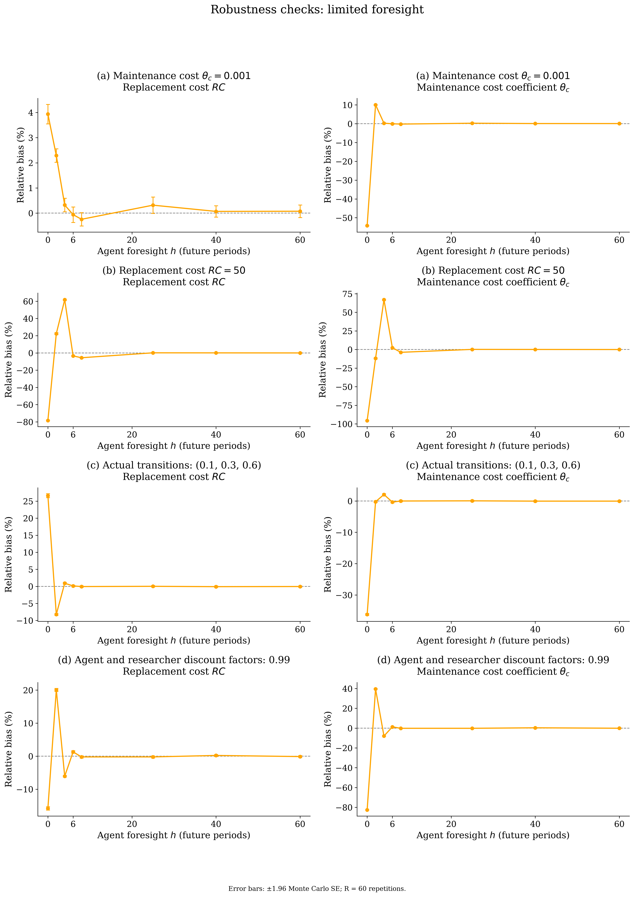

# Dynamic Discrete Choice Models under Misspecification

**Structural Estimation · Dynamic Programming · Monte Carlo Simulation**


---

## Overview

This project investigates the robustness of structural parameter estimation in dynamic discrete choice models when assumptions about agents' decision-making behaviour are misspecified.

Building on the canonical bus engine replacement model of Rust (1987), the project implements a Python-based framework combining dynamic programming, stochastic simulation, maximum likelihood estimation and Monte Carlo experiments.

> **Research question:** Can structural parameters be accurately recovered when the assumed decision-making model differs from the true behaviour of economic agents?

A central finding is that structural estimation exhibits remarkable robustness to limited foresight: in the baseline specification, just six periods of foresight suffice to obtain estimates close to those under fully forward-looking behaviour.

## The Underlying Decision Problem

Consider a fleet manager who must repeatedly decide whether to maintain or replace a bus engine.

- **Maintain:** Avoid an immediate replacement cost but face increasing maintenance costs as mileage accumulates.
- **Replace:** Incur an upfront replacement cost but reset accumulated mileage and reduce future maintenance costs.
- **Uncertainty:** Future mileage evolves stochastically.

The optimal decision depends not only on current costs but also on expected future costs, intertemporal preferences and the agent's planning horizon.

This constitutes a stochastic dynamic optimisation problem in which current decisions affect future states and payoffs.

The econometrician observes decisions and realised mileage but does not directly observe the underlying cost parameters. The objective of structural estimation is to recover these parameters from observed behaviour.

## Why Misspecification Matters

Structural estimation requires assumptions about how agents make decisions. However, these assumptions may differ from their actual behaviour.

For example, an agent with limited foresight may replace an engine less frequently because they fail to account for sufficiently distant future maintenance costs.

An econometrician who incorrectly assumes fully forward-looking behaviour may instead interpret this behaviour as evidence of higher replacement costs or lower maintenance costs.

Incorrect behavioural assumptions can therefore translate into systematically biased parameter estimates.

## Research Framework

The project investigates three dimensions of behavioural misspecification:

| Dimension | Source of Misspecification |
| :--- | :--- |
| Limited foresight | Agents consider fewer future periods than assumed by the econometrician. |
| Discount factor | Agents discount future payoffs differently from what the econometrician assumes. |
| Subjective transition beliefs | Agents' expectations about future states differ from the objective transition probabilities. |

Additional robustness experiments investigate whether the findings persist under alternative model parameterisations.

## Monte Carlo Experimental Design

The project uses a controlled simulation-based approach to quantify estimation bias.

1. **Specify the ground truth:** Define a model with known structural parameters and stochastic state transitions.
2. **Solve the model:** Compute optimal decision rules under alternative behavioural assumptions.
3. **Simulate data:** Generate individual decision trajectories and state transitions.
4. **Estimate parameters:** Apply two-stage maximum likelihood estimation under potentially misspecified assumptions.
5. **Evaluate accuracy:** Compare estimated parameters against their known true values.
6. **Repeat:** Conduct Monte Carlo simulations to distinguish systematic estimation bias from sampling variability.

Unlike in empirical applications, the true structural parameters are known, allowing estimation bias to be directly quantified.

### Computational Workflow


## Key Research Findings

### 1. Remarkable Robustness to Limited Foresight

The most striking finding is the robustness of structural estimation to misspecification of agents' planning horizons.

Despite the econometrician imposing fully forward-looking behaviour, just **six periods of foresight** suffice in the baseline specification to obtain estimates close to those under correct model specification.

For sufficiently short planning horizons, however, the original Monte Carlo experiments reveal substantial distortions:

- Replacement costs are overestimated by approximately **30%**.
- Maintenance cost parameters are underestimated by up to **50%**.

Beyond a relatively short planning horizon, estimation bias becomes negligible.

**Implication:** Behavioural misspecification does not necessarily translate into substantial estimation bias. Agents need not be fully forward-looking for a fully forward-looking econometric model to recover structural parameters accurately in this setting.

### 2. Discount Factor Misspecification

Incorrect assumptions about agents' intertemporal preferences systematically distort structural parameter estimates.

When agents discount future payoffs more heavily than assumed by the econometrician, the model tends to overestimate replacement costs and underestimate maintenance costs.

**Implication:** Differences in intertemporal preferences can be incorrectly attributed to differences in underlying cost parameters.

### 3. Subjective Transition Beliefs

Discrepancies between agents' subjective expectations and objective state transition probabilities generate particularly pronounced estimation bias.

**Implication:** Correctly specifying the objective evolution of economic states is not necessarily sufficient. Agents' beliefs about that evolution also matter for structural estimation.

### 4. Robustness of Transition Parameter Estimation

While behavioural misspecification can substantially distort utility parameter estimates, the first-stage estimates of objective transition probabilities remain comparatively robust in the original experiments.

**Implication:** Different components of the structural estimation procedure exhibit different degrees of sensitivity to misspecification.

## Selected Results

### Limited Foresight


### Discount Factor Misspecification


### Subjective Transition Beliefs


### Robustness Analysis



Additional parameter estimates, replacement frequencies, figures and statistical tables are available in the corresponding repository directories.

## Computational Methodology

The project combines methods from statistical inference, numerical optimisation and computational economics:

- Dynamic programming and Bellman equations
- Backward induction and value function computation
- Markovian state transitions
- Stochastic simulation
- Discrete choice probability modelling
- Two-stage maximum likelihood estimation
- Numerical optimisation
- Monte Carlo simulation
- Sensitivity analysis and robustness testing

The modular implementation separates model specification, numerical solution, simulation, estimation and statistical evaluation, facilitating systematic counterfactual experiments and model extensions.

## Repository Structure

```text
.
├── config.py
├── model.py
├── solver.py
├── transitions.py
├── limited_foresight.py
├── simulation.py
├── estimation.py
├── utility_estimation.py
├── monte_carlo_variant1.py
├── monte_carlo_variant2.py
├── monte_carlo_variant3.py
├── monte_carlo_robustness.py
├── plot_results.py
├── plot_appendix.py
├── figures/
├── results/
└── tables/
```

| Component | Purpose |
| :--- | :--- |
| Model and solver | Model specification and dynamic optimisation |
| Transitions and simulation | Stochastic data generation |
| Estimation | Structural parameter recovery |
| Monte Carlo experiments | Quantification of estimation bias |
| Robustness experiments | Sensitivity to alternative parameterisations |
| Plotting | Statistical visualisation |
| Results and tables | Simulation outputs and aggregated estimates |

## Technology Stack

| Technology | Application |
| :--- | :--- |
| Python | Computational implementation |
| NumPy | Numerical computation |
| SciPy | Numerical optimisation and statistical computation |
| pandas | Data processing and statistical aggregation |
| Matplotlib | Research visualisation |
| Git | Version control |

## Broader Relevance

Although the underlying application concerns bus engine replacement, the project addresses a fundamental statistical problem: the reliability of parameter estimation when the assumed model differs from the true data-generating process.

The research is relevant to:

- Statistical modelling and inference
- Sequential decision-making under uncertainty
- Stochastic optimisation
- Computational economics
- Model risk and validation
- Quantitative finance

The central objective is to understand not only whether modelling assumptions are incorrect, but also when and to what extent these errors affect statistical inference.

## Reproducibility

The repository includes the Python implementation, Monte Carlo outputs, statistical tables and research visualisations.

The Python implementation revisits computational experiments originally developed in MATLAB. The findings reported above originate from the original research. Numerical differences may arise from random number generation, optimisation routines and implementation details.

Exact numerical agreement with the original results is not claimed.

## Academic Background

This project builds on original research conducted at Heinrich Heine University Düsseldorf.

The underlying research was recognised with the **DCE Consult/IHK Award for Best Thesis**.

## Reference

Rust, J. (1987). Optimal Replacement of GMC Bus Engines: An Empirical Model of Harold Zurcher. *Econometrica*, 55(5), 999–1033.

---

## Author

**Elias Roth**

MPhil Economics | University of Oxford

[GitHub Profile](https://github.com/ERoth2002)
