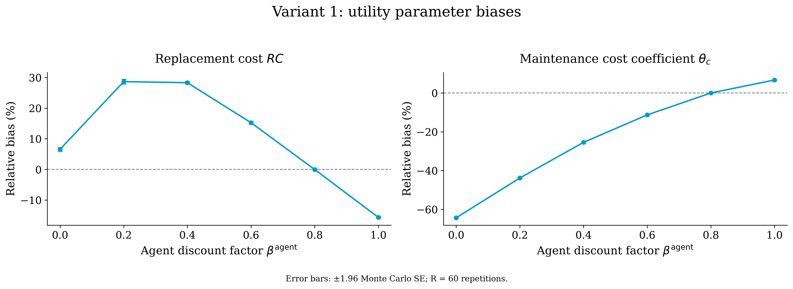

# Dynamic Discrete Choice Models under Misspecification

**Structural Estimation · Dynamic Programming · Monte Carlo Simulation**


---

## Overview

This project investigates the sensitivity of structural parameter estimates in dynamic discrete choice models to misspecification of agents' behavioural assumptions.

Building on the canonical bus engine replacement model of Rust (1987), the project implements a Python-based computational framework for simulating dynamic decision-making under uncertainty, estimating structural parameters, and evaluating estimator robustness through Monte Carlo experiments.

> **Research question:** Can structural parameters be reliably recovered when the econometrician's assumptions about agents' decision-making processes differ from their actual behaviour?

## Research Framework

Three dimensions of behavioural misspecification are investigated:

| Dimension | Research Objective |
| :--- | :--- |
| Limited foresight | Evaluate estimation bias when agents optimise over shorter planning horizons. |
| Discount factor | Examine the consequences of misspecified intertemporal preferences. |
| Subjective transition beliefs | Investigate discrepancies between subjective expectations and objective state transition probabilities. |

## Computational Methodology

- Dynamic programming and Bellman equations
- Backward induction and value function computation
- Stochastic state transitions
- Simulation of individual decision trajectories
- Two-stage maximum likelihood estimation
- Numerical optimisation
- Monte Carlo simulations
- Sensitivity analysis and robustness checks

The computational framework separates model specification, simulation, estimation and statistical evaluation, facilitating systematic counterfactual experiments.

## Key Research Findings

The original research identifies three central findings:

- **Limited foresight:** Six periods of foresight suffice in the baseline specification to produce estimates close to those obtained under fully forward-looking behaviour.
- **Discount factor misspecification:** Incorrect assumptions about intertemporal preferences systematically distort structural parameter estimates.
- **Subjective transition beliefs:** Misspecified expectations about future states generate particularly pronounced estimation bias.

## Selected Results

### Limited Foresight



### Discount Factor Misspecification


### Subjective Transition Beliefs


### Robustness Analysis


## Repository Structure

```text
.
├── config.py
├── model.py
├── solver.py
├── transitions.py
├── limited_foresight.py
├── simulation.py
├── estimation.py
├── utility_estimation.py
├── monte_carlo_variant1.py
├── monte_carlo_variant2.py
├── monte_carlo_variant3.py
├── monte_carlo_robustness.py
├── plot_results.py
├── plot_appendix.py
├── figures/
├── results/
└── tables/
```

| Component | Function |
| :--- | :--- |
| Model and solver | Model specification and dynamic optimisation |
| Transitions and simulation | Stochastic data generation |
| Estimation | Structural parameter recovery |
| Monte Carlo experiments | Statistical evaluation under misspecification |
| Plotting | Visualisation and statistical reporting |
| Results | Monte Carlo outputs and aggregated estimates |

## Technology Stack

| Library | Application |
| :--- | :--- |
| Python | Computational implementation |
| NumPy | Numerical computation |
| SciPy | Numerical optimisation |
| pandas | Data processing and statistical aggregation |
| Matplotlib | Research visualisation |

## Reproducibility

The repository includes the underlying Python implementation, Monte Carlo outputs, statistical tables and research visualisations.

The Python implementation revisits the original computational experiments. Numerical differences may arise from random number generation, optimisation routines and implementation details. Exact numerical agreement with the original results is not claimed.

## Academic Background

This project builds on original research conducted at Heinrich Heine University Düsseldorf, recognised with the **DCE Consult/IHK Award for Best Thesis**.

## Reference

Rust, J. (1987). Optimal Replacement of GMC Bus Engines: An Empirical Model of Harold Zurcher. *Econometrica*, 55(5), 999–1033.

---

## Author

**Elias Roth**

MPhil Economics | University of Oxford

[GitHub Profile](https://github.com/ERoth2002)
