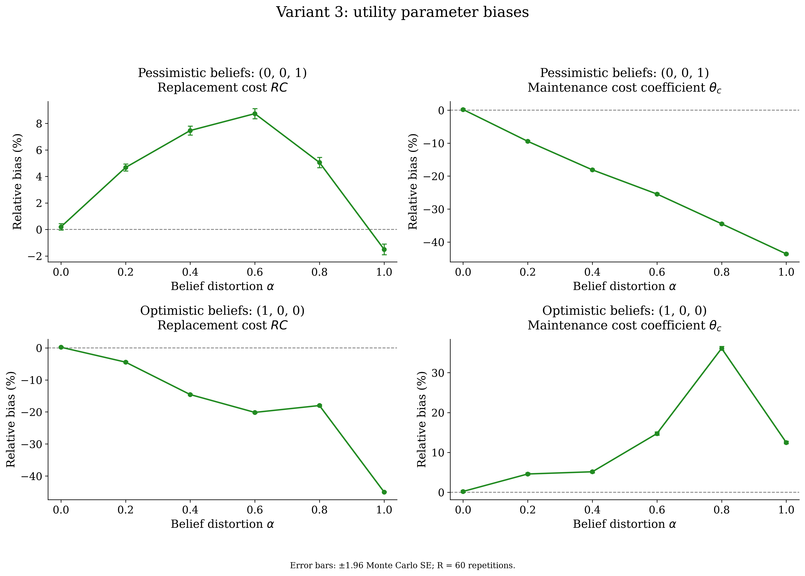

# Dynamic Discrete Choice Models under Misspecification

**Structural Estimation · Dynamic Programming · Monte Carlo Simulation**


---

## Overview

This project investigates the robustness of structural parameter estimation in dynamic discrete choice models when assumptions about agents' decision-making behaviour are misspecified.

Building on the canonical bus engine replacement model of Rust (1987), the project implements a Python-based framework combining dynamic programming, stochastic simulation, maximum likelihood estimation and Monte Carlo experiments.

> **Research question:** Can structural parameters be accurately recovered when the assumed decision-making model differs from the true behaviour of economic agents?

A central finding is that structural estimation exhibits remarkable robustness to limited foresight: in the baseline specification, just six periods of foresight suffice to obtain estimates close to those under fully forward-looking behaviour.

For the mathematical framework and detailed experimental design, see the [Technical Methodology](METHODOLOGY.md).

<br>

## The Underlying Decision Problem

Consider a fleet manager who must repeatedly decide whether to maintain or replace a bus engine.

- **Maintain:** Avoid an immediate replacement cost but face increasing maintenance costs as mileage accumulates.
- **Replace:** Incur an upfront replacement cost but reset accumulated mileage and reduce future maintenance costs.
- **Uncertainty:** Future mileage evolves stochastically.

The optimal decision depends not only on current costs but also on expected future costs, intertemporal preferences and the agent's planning horizon.

This constitutes a stochastic dynamic optimisation problem in which current decisions affect future states and payoffs.

The econometrician observes decisions and realised mileage but does not directly observe the underlying cost parameters. The objective of structural estimation is to recover these parameters from observed behaviour.

<br>

## Why Misspecification Matters

Structural estimation requires assumptions about how agents make decisions. However, these assumptions may differ from their actual behaviour.

For example, an agent with limited foresight may replace an engine less frequently because they do not account for sufficiently distant future maintenance costs.

An econometrician who incorrectly assumes fully forward-looking behaviour may instead interpret this behaviour as evidence of higher replacement costs or lower maintenance costs.

Incorrect behavioural assumptions can therefore translate into systematically biased parameter estimates.

<br>

## Research Framework

The project investigates three dimensions of behavioural misspecification:

| Dimension | Source of Misspecification |
| :--- | :--- |
| Discount factor | Agents discount future payoffs differently from what the econometrician assumes. |
| Limited foresight | Agents consider fewer future periods than assumed by the econometrician. |
| Subjective transition beliefs | Agents' expectations about future states differ from objective transition probabilities. |

<br>

Additional robustness experiments investigate whether the findings concerning limited foresight persist under alternative model parameterisations.

<br>

## Monte Carlo Experimental Design

The project uses a controlled simulation-based approach:

1. Specify a dynamic decision-making model with known structural parameters.
2. Solve the model under alternative behavioural assumptions.
3. Simulate individual decisions and stochastic state transitions.
4. Estimate structural parameters under potentially misspecified assumptions.
5. Compare estimated parameters against their known true values.
6. Repeat the experiment to distinguish systematic estimation bias from sampling variability.

### Experimental Scale

| Metric | Value |
| :--- | ---: |
| Simulated buses per repetition | 1,000 |
| Decision periods per bus | 60 |
| Discrete mileage states | 71 |
| Monte Carlo repetitions per specification | 60 |
| Decision observations per repetition | 60,000 |
| Decision observations per specification | 3,600,000 |

<br>

Unlike in empirical applications, the true structural parameters are known, allowing estimation bias to be directly quantified.

<br>

## Key Research Findings

The following findings originate from the original research.

### 1. Remarkable Robustness to Limited Foresight

The most striking finding is the robustness of structural estimation to misspecification of agents' planning horizons.

Despite the econometrician imposing fully forward-looking behaviour, just **six periods of foresight** suffice in the baseline specification for estimation bias to become statistically indistinguishable from zero.

For sufficiently short planning horizons, however, substantial distortions arise:

- Estimated replacement costs deviate by up to approximately **30%**.
- Estimated maintenance cost parameters deviate by more than **50%** in some cases.

The original simulations reveal the following relationship between foresight and replacement behaviour:

| Future Periods Considered | Average Replacements per Bus |
| ---: | ---: |
| 0 | 5.75 |
| 2 | 11.77 |
| 4 | 11.56 |
| **6** | **11.47** |
| 8 | 11.50 |
| 25 | 11.50 |
| 40 | 11.50 |
| 60 | 11.50 |

<br>

From six periods onwards, average replacement behaviour closely resembles that of a fully forward-looking agent.

Remarkably, this coincides with the planning horizon at which estimation bias becomes statistically indistinguishable from zero.

**Implication:** Behavioural assumptions can be formally incorrect without generating substantial estimation bias, provided they remain compatible with actual decision-making behaviour.

Agents do not necessarily need to be fully forward-looking for a fully forward-looking econometric model to recover structural parameters accurately.

The six-period threshold is specific to the baseline calibration. Additional robustness experiments investigate this mechanism under alternative parameterisations.

### 2. Discount Factor Misspecification

Incorrect assumptions about agents' intertemporal preferences systematically distort structural parameter estimates.

Even moderate deviations from the assumed discount factor generate estimation bias of approximately 20% in the original experiments.

When agents discount future payoffs more heavily than assumed by the econometrician, replacement costs tend to be overestimated and maintenance costs underestimated. The opposite pattern arises when agents are more future-oriented than assumed.

**Implication:** Differences in intertemporal preferences can be incorrectly attributed to differences in underlying cost parameters.

### 3. Subjective Transition Beliefs

Discrepancies between agents' subjective expectations and objective state transition probabilities generate substantial estimation bias.

A particularly important finding is that utility parameter distortions can arise precisely because correctly estimated objective transition probabilities are used to model decisions that are actually based on different subjective expectations.

**Implication:** Accurately estimating the objective stochastic environment is not sufficient when agents make decisions based on different beliefs about that environment.

### 4. Robustness of Transition Parameter Estimation

Across all three misspecification variants, estimates of objective transition probabilities remain comparatively robust, while utility parameter estimates are considerably more sensitive.

**Implication:** Different components of the structural estimation procedure exhibit different degrees of sensitivity to behavioural misspecification.

### Central Conclusion

The consequences of model misspecification depend not merely on whether assumptions are formally correct, but on whether the behaviour implied by those assumptions is compatible with the actual data-generating process.

This distinction is fundamental to understanding when structural estimation remains reliable despite imperfect modelling assumptions.

<br>

## Selected Results

The following figures are generated by the Python implementation.

### Limited Foresight


<br>

### Discount Factor Misspecification


<br>

### Subjective Transition Beliefs



<br>

### Robustness Analysis


Additional transition parameter estimates, replacement frequencies and statistical tables are available in the [figures](figures/), [results](results/) and [tables](tables/) directories.

<br>

## Computational Methodology

The project combines methods from statistical inference, numerical optimisation and computational economics:

- Dynamic programming and Bellman equations
- Backward induction
- Markovian state transitions
- Stochastic simulation
- Two-stage maximum likelihood estimation
- Numerical optimisation
- Monte Carlo analysis
- Sensitivity analysis and robustness testing

The modular implementation separates model specification, numerical solution, simulation, estimation and statistical evaluation, facilitating systematic counterfactual experiments and model extensions.

For the complete mathematical derivations, model assumptions, parameter calibration and estimation algorithms, see the [Technical Methodology](METHODOLOGY.md).

<br>

## Repository Structure

```text
.
├── README.md
├── METHODOLOGY.md
│
├── config.py
├── model.py
├── solver.py
├── transitions.py
├── limited_foresight.py
├── simulation.py
├── estimation.py
├── utility_estimation.py
│
├── monte_carlo_variant1.py
├── monte_carlo_variant2.py
├── monte_carlo_variant3.py
├── monte_carlo_robustness.py
│
├── plot_results.py
├── plot_appendix.py
│
├── figures/
├── results/
└── tables/
```

<br>

## Technology Stack

**Python · NumPy · SciPy · pandas · Matplotlib · Git**

<br>

## Broader Relevance

Although the application concerns bus engine replacement, the project addresses a fundamental statistical problem: the reliability of parameter estimation when the assumed model differs from the true data-generating process.

The research is relevant to statistical inference, sequential decision-making under uncertainty, stochastic optimisation, model risk and quantitative finance.

Its central contribution is to investigate not only whether modelling assumptions are incorrect, but also when and to what extent such errors affect statistical inference.

<br>

## Reproducibility

The repository includes the Python implementation, Monte Carlo outputs, statistical tables and research visualisations.

Detailed information on model specification, experimental parameters and estimation procedures is available in the [Technical Methodology](METHODOLOGY.md).

<br>

## Academic Background

This project builds on original research conducted at the Düsseldorf Institute for Competition Economics (DICE), Heinrich Heine University Düsseldorf.

The research was recognised with the **IHK Award for Best Thesis**.

<br>

## Reference

Rust, J. (1987). Optimal Replacement of GMC Bus Engines: An Empirical Model of Harold Zurcher. *Econometrica*, 55(5), 999–1033.

---

## Author

**Elias Roth**

MPhil Economics | University of Oxford

[GitHub Profile](https://github.com/ERoth2002)
