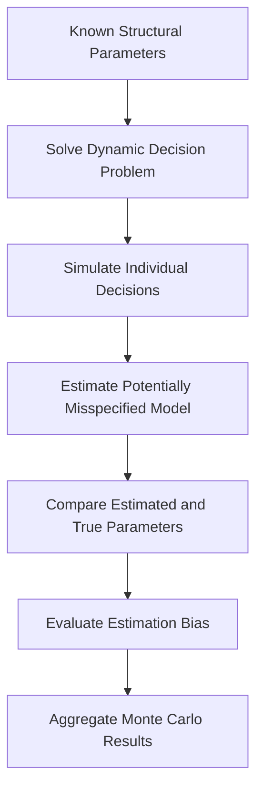

# Dynamic Discrete Choice Models under Misspecification

**Structural Estimation · Dynamic Programming · Monte Carlo Simulation**


---

## Overview

This project investigates the sensitivity of structural parameter estimates in dynamic discrete choice models to misspecification of agents' behavioural assumptions.

Building on the canonical bus engine replacement model of Rust (1987), the project implements a Python-based computational framework for simulating dynamic decision-making under uncertainty, estimating structural parameters, and evaluating estimator robustness through Monte Carlo experiments.

> **Research question:** Can structural parameters be reliably recovered when the econometrician's assumptions about agents' decision-making processes differ from their actual behaviour?

## The Underlying Decision Problem

Consider a fleet manager who must repeatedly decide whether to maintain or replace a bus engine.

- **Maintain:** Avoid an immediate replacement cost but face increasing future maintenance costs as mileage accumulates.
- **Replace:** Incur a substantial upfront replacement cost but reset the engine's accumulated mileage and reduce future maintenance costs.
- **Uncertainty:** Future mileage is stochastic, meaning that future maintenance costs are not known with certainty.

The optimal decision therefore depends not only on current costs, but also on expectations about future costs, intertemporal preferences and the planning horizon of the decision-maker.

This constitutes a stochastic dynamic optimisation problem in which current decisions affect future states and payoffs.

The econometrician observes the realised decisions and state transitions but does not directly observe the underlying cost parameters governing the agent's behaviour.

The objective of structural estimation is to recover these unobserved parameters from observed behaviour.

## Why Misspecification Matters

Structural estimation relies on assumptions about how economic agents make decisions. However, these assumptions may not accurately reflect their actual behaviour.

For instance, an econometrician may assume that agents fully anticipate future costs, while in reality they consider only a limited number of future periods.

Suppose an agent replaces an engine less frequently because they underestimate future maintenance costs. An econometrician who incorrectly assumes fully forward-looking behaviour might instead interpret this behaviour as evidence of high replacement costs or low maintenance costs.

Consequently, incorrect behavioural assumptions can translate into systematically biased structural parameter estimates.

This project investigates the magnitude, direction and persistence of such estimation bias.

## Research Framework

Three dimensions of behavioural misspecification are investigated:

| Dimension | Source of Misspecification | Research Objective |
| :--- | :--- | :--- |
| Limited foresight | Agents consider fewer future periods than assumed by the econometrician. | Quantify estimation bias arising from restricted planning horizons. |
| Discount factor | Agents discount future payoffs differently from what the econometrician assumes. | Examine the consequences of misspecified intertemporal preferences. |
| Subjective transition beliefs | Agents' expectations about future states differ from the objective transition process used by the econometrician. | Investigate how incorrect assumptions about expectations affect structural estimation. |

Additional robustness experiments assess the sensitivity of the findings to alternative model parameterisations.

## Monte Carlo Experimental Design

To isolate the effects of behavioural misspecification, the project employs a controlled simulation-based approach.

1. **Specify the ground truth:** Define a dynamic decision-making model with known structural parameters and stochastic state transitions.

2. **Solve the decision problem:** Compute optimal decision rules under alternative behavioural assumptions using dynamic programming.

3. **Generate synthetic data:** Simulate individual decision trajectories and realised state transitions.

4. **Estimate structural parameters:** Apply a two-stage maximum likelihood estimation procedure using a potentially misspecified econometric model.

5. **Evaluate estimation accuracy:** Compare estimated parameters against their known true values.

6. **Repeat the experiment:** Conduct Monte Carlo simulations to distinguish systematic estimation bias from sampling variability.

The advantage of this approach is that the true structural parameters are known. Unlike in empirical applications, estimation errors can therefore be directly observed and quantified.

### Computational Workflow



## Computational Methodology

The project combines methods from numerical optimisation, probability theory, statistical estimation and computational economics.

- Dynamic programming and Bellman equations
- Backward induction and value function computation
- Markovian state transitions
- Stochastic simulation
- Discrete choice probability modelling
- Two-stage maximum likelihood estimation
- Numerical optimisation
- Monte Carlo experiments
- Sensitivity analysis
- Robustness testing
- Statistical visualisation

The computational framework separates model specification, numerical solution, simulation, estimation and statistical evaluation.

This modular architecture allows individual components to be modified independently, facilitating systematic counterfactual experiments and extensions to the underlying model.

## Key Research Findings

The original research identifies three central findings.

### 1. Limited Foresight

In the baseline specification, six periods of foresight suffice to produce estimates close to those obtained under fully forward-looking behaviour.

Shorter planning horizons can generate substantial estimation bias, particularly in the estimated replacement and maintenance cost parameters.

This suggests that fully forward-looking behaviour need not always be an accurate description of agents' actual decision-making processes for structural estimation to perform well.

### 2. Discount Factor Misspecification

Incorrect assumptions about agents' intertemporal preferences systematically distort structural parameter estimates.

When agents discount future payoffs more heavily than assumed by the econometrician, differences in observed behaviour may be incorrectly attributed to differences in underlying cost parameters.

### 3. Subjective Transition Beliefs

Discrepancies between agents' subjective expectations and the objective state transition process generate particularly pronounced estimation bias.

These findings highlight the importance of distinguishing between the actual evolution of economic states and agents' beliefs about their future evolution.

## Selected Results

The following figures illustrate the estimated utility parameters across alternative misspecification scenarios.

### Limited Foresight


### Discount Factor Misspecification


### Subjective Transition Beliefs


### Robustness Analysis


Additional results, transition parameter estimates, replacement frequencies and statistical tables are available in the corresponding repository directories.

## Repository Structure

```text
.
├── config.py
├── model.py
├── solver.py
├── transitions.py
├── limited_foresight.py
├── simulation.py
├── estimation.py
├── utility_estimation.py
├── monte_carlo_variant1.py
├── monte_carlo_variant2.py
├── monte_carlo_variant3.py
├── monte_carlo_robustness.py
├── plot_results.py
├── plot_appendix.py
├── figures/
├── results/
└── tables/
```

| File / Directory | Description |
| :--- | :--- |
| `config.py` | Model parameters and experimental configuration |
| `model.py` | Dynamic discrete choice model specification |
| `solver.py` | Numerical solution of the dynamic optimisation problem |
| `transitions.py` | Stochastic state transition dynamics |
| `limited_foresight.py` | Limited-foresight decision-making framework |
| `simulation.py` | Simulation of individual decision trajectories |
| `estimation.py` | Structural estimation framework |
| `utility_estimation.py` | Utility parameter estimation |
| `monte_carlo_variant1.py` | Monte Carlo experiments on limited foresight |
| `monte_carlo_variant2.py` | Monte Carlo experiments on discount factor misspecification |
| `monte_carlo_variant3.py` | Monte Carlo experiments on subjective transition beliefs |
| `monte_carlo_robustness.py` | Additional robustness experiments |
| `plot_results.py` | Visualisation of Monte Carlo results |
| `plot_appendix.py` | Additional figures and statistical tables |
| `figures/` | Research visualisations |
| `results/` | Raw simulation outputs and aggregated estimates |
| `tables/` | Statistical tables and comparative results |

## Technology Stack

| Technology | Application |
| :--- | :--- |
| Python | Computational implementation |
| NumPy | Numerical computation and array operations |
| SciPy | Numerical optimisation and statistical computation |
| pandas | Data processing and statistical aggregation |
| Matplotlib | Research visualisation |
| Git | Version control |

## Broader Relevance

Although the underlying application concerns bus engine replacement, the research addresses a more general statistical problem: the reliability of parameter estimation when the assumed model differs from the true data-generating process.

This problem is relevant across numerous quantitative disciplines, including:

- Statistical modelling and inference
- Sequential decision-making under uncertainty
- Stochastic optimisation
- Computational economics
- Model risk and validation
- Quantitative finance
- Simulation-based estimation

The project provides a computational framework for systematically investigating how incorrect modelling assumptions translate into estimation errors.

## Reproducibility

The repository contains the underlying Python implementation, Monte Carlo outputs, statistical tables and research visualisations.

The Python implementation revisits computational experiments originally developed in MATLAB.

Numerical differences may arise from random number generation, numerical optimisation routines and implementation details. Exact numerical agreement with the original results is not claimed.

The modular structure facilitates further sensitivity analysis, alternative parameter configurations and extensions to the underlying decision-making model.

## Academic Background

This project builds on original research conducted at Heinrich Heine University Düsseldorf.

The underlying research was recognised with the **DCE Consult/IHK Award for Best Thesis**.

## Reference

Rust, J. (1987). Optimal Replacement of GMC Bus Engines: An Empirical Model of Harold Zurcher. *Econometrica*, 55(5), 999–1033.

---

## Author

**Elias Roth**

MPhil Economics | University of Oxford

[GitHub Profile](https://github.com/ERoth2002)
