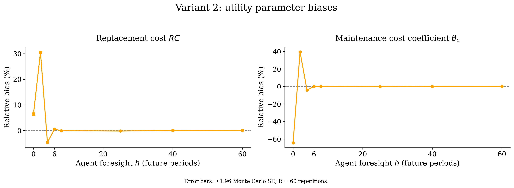

# Dynamic Discrete Choice Models under Misspecification

**Dynamic Programming · Statistical Modelling · Numerical Optimisation · Monte Carlo Simulation**


## Overview

When do incorrect model assumptions lead to unreliable parameter estimates?

I developed a Python simulation and structural estimation framework to investigate parameter recovery under model misspecification in sequential decision-making problems under uncertainty. Based on Rust's (1987) dynamic discrete choice model, the framework combines finite-horizon dynamic programming, stochastic simulation and two-stage maximum likelihood estimation to quantify the effects of incorrect assumptions about planning horizons, discount factors and expectations about future states.

**Key finding:** In the baseline calibration, assuming full foresight produces less than **1% relative bias** in both cost estimates when agents consider only six future periods. By contrast, misspecified transition beliefs can lead to replacement cost estimates that are approximately **45% too low**.

This project implements my bachelor's thesis at the Düsseldorf Institute for Competition Economics (DICE), Heinrich Heine University Düsseldorf, which received the **IHK Düsseldorf Award for Best Thesis**.

[Technical Methodology](METHODOLOGY.md) · [Simulation Outputs](results/) · [Figures](figures/)

<br>

## Project Highlights

| Experimental scale | Value |
| :--- | ---: |
| Total simulated decision observations | **93,600,000** |
| Two-stage parameter estimations | **1,560** |
| Experimental specifications | 26 |
| Monte Carlo repetitions per specification | 60 |
| Agents × decision periods per repetition | 1,000 × 60 |
| Discrete states | 71 |
| Dimensions of misspecification | 3 |

Totals include the repeated undistorted-belief baseline shared by the two subjective-belief experiments.

<br>

## Computational Methods

- **Dynamic programming:** Solve finite-horizon stochastic decision problems by backward induction, allowing distinct behavioural assumptions in simulation and estimation.
- **Statistical estimation:** Implement two-stage maximum likelihood estimation to recover transition probabilities and structural utility parameters.
- **Numerical optimisation:** Rescale parameters to improve numerical conditioning and use bounded L-BFGS-B optimisation with a Nelder–Mead fallback.
- **Computational efficiency:** Aggregate observations by action, state and period to avoid repeatedly processing the full simulated panel during likelihood evaluation.
- **Numerical stability:** Evaluate value functions and log choice probabilities using stable log-sum-exp calculations.
- **Monte Carlo analysis:** Quantify parameter bias and simulation uncertainty across controlled, reproducible experiments.
- **Model validation:** Verify limiting cases, convergence and consistency across equivalent experimental specifications.

Formal model specification, likelihood derivations and numerical algorithms are provided in the [Technical Methodology](METHODOLOGY.md).

<br>

## The Decision Problem

A fleet manager decides each month whether to maintain or replace a bus engine over a 60-month operating horizon.

- **Maintain:** Avoid the replacement cost but incur maintenance costs that increase with accumulated mileage.
- **Replace:** Pay the replacement cost, reset mileage and potentially reduce future maintenance costs.

Monthly mileage growth is stochastic, taking values of 0, 5,000 or 10,000 km. Optimal decisions therefore depend on expectations about future states, the planning horizon and the discount factor.

The researcher observes decisions and realised mileage but not the underlying cost parameters. Estimation proceeds in two stages:

1. Estimate objective transition probabilities from observed mileage increases without engine replacement.
2. Estimate the replacement cost (**RC**) and maintenance cost coefficient (**θ<sub>c</sub>**) by maximising the conditional-choice likelihood under the researcher's behavioural assumptions.

Incorrect assumptions can cause the estimator to attribute differences in behaviour to differences in structural parameters.

<br>

## Selected Results

Across all three experiments, the researcher assumes full foresight, a discount factor of 0.8 and expectations consistent with the objective transition probabilities. Each experiment varies one aspect of the agent's behaviour while holding the remaining assumptions fixed.

Figures report relative parameter biases across 60 Monte Carlo repetitions per specification. Error bars represent ±1.96 Monte Carlo standard errors of the estimated mean bias.

### 1. Limited Foresight

**Researcher's assumption:** The agent considers all remaining periods.

**Agent's actual behaviour:** The agent considers at most the next *h* periods. With *h* = 0, only immediate costs matter; with *h* = 60, the agent has full foresight.



**Intuition:** A myopic agent ignores future maintenance savings, making replacement less attractive than the researcher predicts. The estimator compensates by raising the replacement cost and lowering the maintenance cost coefficient. At intermediate horizons, biases need not move monotonically because estimation depends on how choices vary across states and periods, not merely on replacement frequencies.

**Key result:** Considering only six future periods is sufficient for both relative biases to fall below 1% in the baseline calibration. Replacement cost bias falls to **+0.53%**, while maintenance coefficient bias falls to **+0.10%**.

A formally incorrect assumption can therefore have little practical effect on parameter recovery. This demonstrates practical robustness rather than exact unbiasedness.

[Underlying Results](results/variant2/summary_R60.csv)

<br>

### 2. Discount Factor Misspecification

**Researcher's assumption:** The agent discounts future utility using a factor of 0.8.

**Agent's actual behaviour:** The discount factor varies between 0 and 1, changing the weight assigned to future utility.


**Intuition:** When the agent discounts the future more heavily than assumed, future maintenance savings are less valuable. The estimator compensates for the lower attractiveness of replacement by raising the replacement cost and lowering the maintenance cost coefficient. The reverse mechanism applies when the agent places greater weight on the future.

**Key result:** At an actual discount factor of 0.6, replacement costs are overestimated by **15.25%**, while the maintenance cost coefficient is underestimated by **11.31%**.

Differences in time preferences are mistaken for differences in underlying costs.

[Underlying Results](results/variant1/summary_R60.csv)

<br>

### 3. Subjective Transition Beliefs

**Researcher's assumption:** The agent evaluates future states using the objective transition probabilities estimated from realised mileage changes.

**Agent's actual behaviour:** The agent holds increasingly pessimistic or optimistic beliefs about future mileage growth. Belief distortion α ranges from 0 (correct beliefs) to 1 (extreme beliefs), while actual transitions continue to follow the objective distribution.


**Intuition:**

- **Pessimistic beliefs:** The agent expects even a new engine to accumulate mileage quickly, reducing the value of replacement. The estimator generally raises the replacement cost and lowers the maintenance cost coefficient.
- **Optimistic beliefs:** The agent expects a new engine to remain at low mileage for longer, increasing the value of replacement. The estimator lowers the replacement cost and tends to raise the maintenance cost coefficient.

**Key result:** Under extreme optimistic beliefs, replacement costs are underestimated by approximately **45%**. Accurately estimated objective transition probabilities do not necessarily reveal the subjective expectations driving observed decisions.

[Optimistic Beliefs](results/variant3/100/summary_R60.csv) · [Pessimistic Beliefs](results/variant3/001/summary_R60.csv)

<br>

## Key Takeaways

- **Sensitivity to model assumptions:** Different forms of misspecification can generate substantially different magnitudes and directions of parameter bias.
- **Practical robustness:** Incorrect assumptions need not materially affect estimation when they have sufficiently small effects on predicted behaviour.
- **Partial parameter recovery:** First-stage transition estimates remain robust because realised mileage growth follows the same objective distribution across experiments. This does not protect second-stage utility estimates from behavioural misspecification.

The central implication is that reliable parameter recovery depends on whether the assumed model adequately captures the mechanism generating observed decisions.

<br>

## Quick Start

Clone the repository and install the dependencies:

```bash
git clone https://github.com/EliasBernhardRoth/Dynamic-Choice-Misspecification.git
cd Dynamic-Choice-Misspecification
python3 -m pip install numpy scipy matplotlib
```

**Run a single baseline estimation:**

```bash
python3 utility_estimation.py
```

Simulates a dataset and reports parameter estimates, likelihood values and optimisation diagnostics.

**Regenerate figures from saved simulation outputs:**

```bash
python3 plot_results.py
```

**Reproduce all Monte Carlo experiments:**

```bash
python3 monte_carlo_variant1.py
python3 monte_carlo_variant2.py
python3 monte_carlo_variant3.py
python3 plot_results.py
```

The default configuration uses 60 repetitions per specification. Experiment settings are defined in [config.py](config.py). Running the experiments rewrites the corresponding output files.

<br>

## Repository Structure

| Component | Files |
| :--- | :--- |
| Technical documentation | [METHODOLOGY.md](METHODOLOGY.md) |
| Model specification and configuration | [model.py](model.py) · [config.py](config.py) |
| Dynamic programming | [solver.py](solver.py) · [limited_foresight.py](limited_foresight.py) |
| State transitions and simulation | [transitions.py](transitions.py) · [simulation.py](simulation.py) |
| Two-stage maximum likelihood | [estimation.py](estimation.py) · [utility_estimation.py](utility_estimation.py) |
| Monte Carlo experiments | [Variant 1](monte_carlo_variant1.py) · [Variant 2](monte_carlo_variant2.py) · [Variant 3](monte_carlo_variant3.py) |
| Visualisation | [plot_results.py](plot_results.py) |
| Research outputs | [figures/](figures/) · [results/](results/) |

<br>

## Reference

Rust, J. (1987). Optimal Replacement of GMC Bus Engines: An Empirical Model of Harold Zurcher. *Econometrica*, 55(5), 999–1033.

---

**Elias Roth**  
MPhil Economics | University of Oxford  
[GitHub Profile](https://github.com/EliasBernhardRoth)
